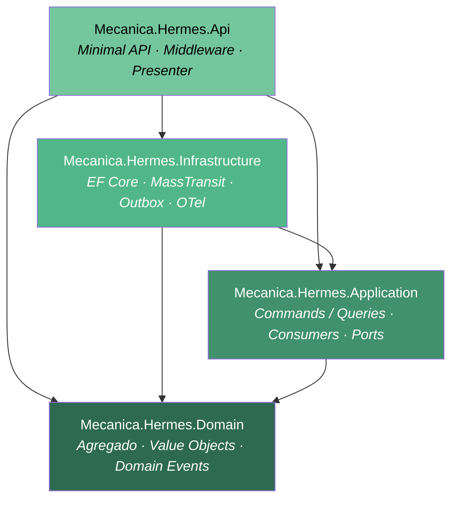

# Arquitetura

## Visão geral

O projeto aplica **Clean Architecture** com **Domain-Driven Design (DDD)**, **CQRS** e
**Hexagonal Architecture (Ports & Adapters)**. O código está organizado em quatro projetos
com dependências unidirecionais.



**Regra de dependência (validada por testes em `Mecanica.Hermes.ArchitectureTests`):**

- `Domain` não depende de ninguém.
- `Application` depende **apenas** de `Domain`.
- `Infrastructure` implementa as ports definidas em `Application`.
- `Api` é o composition root e referencia todos os demais.

## Projetos

| Projeto | Responsabilidade |
| --- | --- |
| `Mecanica.Hermes.Domain` | Agregado `OrdemDeServico`, value objects, domain events, `Result<T>`, paginação |
| `Mecanica.Hermes.Application` | Commands/Queries (MediatR), Consumers (MassTransit), Ports, behaviors |
| `Mecanica.Hermes.Infrastructure` | EF Core, repositórios, Outbox, SAGA, JWT, observabilidade |
| `Mecanica.Hermes.Api` | Endpoints (Minimal API), middleware, presenter, validators, OpenAPI |

## Camada por camada

### `Mecanica.Hermes.Api`

```text
Mecanica.Hermes.Api/
├─ Endpoints/OrdensDeServico/
│  ├─ Contracts/                  Request/Response DTOs do contrato HTTP
│  ├─ Mappings/                   Manual mapping (Domain DTO ↔ Response)
│  ├─ Routes/                     Uma classe por endpoint (extension method)
│  ├─ Validators/                 FluentValidation por request body
│  └─ OrdensDeServicoEndpoints.cs Registra o group e mapeia todas as rotas
├─ Filters/                       ValidationFilter<T> para FluentValidation
├─ Middleware/                    Correlation, ExceptionHandler, DevAuth
├─ Presenter/                     Result<T> → IResult HTTP (RFC 7807 em falha)
└─ Program.cs                     Composition root + pipeline HTTP
```

Cada handler de rota segue o padrão: parse → command/query → `sender.Send` →
`response.Present()`.

### `Mecanica.Hermes.Application`

```text
Mecanica.Hermes.Application/
├─ Common/
│  ├─ Behaviors/                  LoggingBehavior, TracingBehavior (MediatR pipeline)
│  ├─ Constants/
│  ├─ Exceptions/                 ConcurrencyConflictException
│  ├─ Messaging/                  AsyncCommandHandler<T>, IAsyncMessagePublisher,
│  │                              OrdemDeServicoConsumerBase + Mutate/Create variants
│  ├─ Pagination/
│  └─ Persistence/                IUnitOfWork
└─ OrdensDeServico/
   ├─ Commands/                   Records IRequest<Result> que viram mensagens MT
   ├─ Queries/                    Records IRequest<Result<T>> + Handlers síncronos
   ├─ Consumers/                  Um consumer por Execute*Command (MassTransit)
   ├─ Messages/
   │  ├─ Requests/                Entrada da SAGA (HTTP → bus)
   │  ├─ Commands/                Internos (SAGA → consumer)
   │  └─ Events/                  Saída dos consumers (consumer → SAGA)
   ├─ Dtos/                       DTOs para queries
   ├─ Mappings/                   Domínio → DTO (manual)
   ├─ Ports/                      IOrdemDeServicoReader, Writer, Repository, IOrdemDeServicoMetrics
   └─ Constants/                  OrdemDeServicoMetricKeys
```

### `Mecanica.Hermes.Domain`

```text
Mecanica.Hermes.Domain/
├─ Common/
│  ├─ Abstractions/               BaseDomain, AggregateRoot, IDomainEvent
│  ├─ Clock/                      IClock — abstração de DateTime.UtcNow
│  ├─ Pagination/                 PaginationParams, PagedResult<T>
│  ├─ Results/                    Result, Result<T> (com HttpStatusCode)
│  └─ EnvironmentNames.cs         Constantes Development/Testing/Production
└─ OrdensDeServico/
   ├─ OrdemDeServico.cs           Agregado raiz
   ├─ OrdemDeServicoProduto.cs    Snapshot de produto (entidade filha)
   ├─ OrdemDeServicoServico.cs    Snapshot de serviço (entidade filha)
   ├─ OrdemDeServicoHistoricoStatus.cs
   ├─ Status/                     State Pattern — uma classe por estado
   ├─ Events/                     OrdemDeServicoCriadoEvent, EtapaAvancadaEvent etc.
   ├─ Enums/                      OrdemDeServicoStatus
   ├─ ValueObjects/               Valor, Quantidade
   └─ Abstractions/               OrdemDeServicoStatusBase, IOrdemDeServicoStatus
```

### `Mecanica.Hermes.Infrastructure`

```text
Mecanica.Hermes.Infrastructure/
├─ Persistence/
│  ├─ AppDbContext.cs             EF Core DbContext (PostgreSQL)
│  ├─ Configurations/             Fluent API por entidade
│  ├─ Entities/                   *Entity — POCOs de persistência (não vê o domínio)
│  ├─ Mappings/                   Conversão Entity ↔ Domain
│  ├─ Repositories/               OrdemDeServicoRepository (Reader + Writer)
│  ├─ UnitOfWork/                 EfUnitOfWork — coleta domain events e grava no Outbox
│  ├─ Events/                     DomainEventDispatcher (publica via MediatR + bus)
│  ├─ Outbox/                     OutboxMessageEntity, OutboxProcessor (BackgroundService),
│  │                              OutboxCleanupService, OutboxOptions, OutboxHealthMetrics
│  └─ Migrations/                 EF Core migrations
├─ MassTransit/
│  ├─ Configurations/             Fábricas, registros, transports (RabbitMQ/SQS/Mongo)
│  ├─ Saga/                       OrdemDeServicoState + StateMachine
│  ├─ Filters/                    Pipeline filters (ex.: tracing)
│  └─ Adapters/                   MassTransitMessagePublisher → IAsyncMessagePublisher
├─ Observability/                 OTel config, OrdemDeServicoMetrics, ActivitySources,
│                                 EnvironmentDetector, Handlers para metrics events
├─ Logging/                       Serilog config + enrichers
├─ Autofac/                       Modules para registro de repositórios
├─ DependencyInjection/           ServiceCollectionExtensions, HostBuilderExtensions, Migrate
└─ Settings/                      VariableNames, AuthPolicies
```

## Patterns aplicados

### State Pattern (status da OS)

Cada estado é uma classe concreta herdando `OrdemDeServicoStatusBase` que define:

- `StatusAtual` — enum identificador.
- `ProximoStatus` / `StatusRevertido` / `StatusCancelado` — alvos das transições.
- `PermiteEditarProdutos` — controla se produtos/serviços podem ser adicionados/removidos.

Estados terminais (`Entregue`, `Cancelada`, `Rejeitada`) sobrescrevem `AvancarEtapa`/
`Cancelar` retornando `Result.BadRequest`. Detalhes do fluxo:
[`service-order-flow.md`](./service-order-flow.md).

### Result pattern

Operações de domínio e aplicação retornam `Result` ou `Result<T>` em vez de lançar exceções
para erros de regra de negócio. O `Result` carrega `IsSuccess`, `Errors` e `HttpStatusCode`,
o que permite ao `ResultPresenter` na API converter diretamente para `IResult` HTTP
(incluindo Problem Details RFC 7807 em falha).

### CQRS via MediatR

**Escrita (assíncrona):**

1. O endpoint cria um `*Command` e envia via `ISender.Send(...)`.
2. Como o command implementa `IAsyncCommand`, o **`AsyncCommandHandler<T>` genérico**
   resolve, publica o `*Request` correspondente via `IAsyncMessagePublisher` e devolve
   `Result.Accepted()` imediatamente — o endpoint responde `202`.
3. A SAGA (ver [messaging.md](./messaging.md)) recebe o `*Request`, transita para
   `Processing`, publica o `Execute*Command` interno e ignora novos `*Request` para o mesmo
   `OrdemDeServicoId` enquanto a operação em voo não terminar.
4. Um consumer dedicado (`OrdemDeServicoMutateConsumerBase<T>` ou `Create...`) processa o
   `Execute*Command`, aplica a regra de domínio, persiste e publica
   `OrdemDeServicoOperationCompleted/Failed`. A SAGA volta para `Initial`.

**Leitura (síncrona):**

Query handlers dependem de `IOrdemDeServicoReader` (somente leitura, ISP) e retornam
`Result<TDto>` direto na requisição HTTP.

### Hexagonal — Ports & Adapters

| Port (Application) | Adapter (Infrastructure) |
| --- | --- |
| `IOrdemDeServicoRepository` (Reader + Writer) | `OrdemDeServicoRepository` (EF Core) |
| `IUnitOfWork` | `EfUnitOfWork` |
| `IAsyncMessagePublisher` | `MassTransitMessagePublisher` |
| `IOrdemDeServicoMetrics` | `OrdemDeServicoMetrics` (OpenTelemetry Meter) |

Os **Consumers** continuam acoplados a `IConsumer<T>` do MassTransit por opção deliberada —
são *driver adapters* de entrada e o `MassTransit.TestFramework` já permite testá-los sem
broker real (ver [ADR-008](./adrs.md#adr-008)).

### Outbox transacional

Domain events disparados pelo agregado são serializados em `OutboxMessages` na **mesma
transação** do `SaveChangesAsync` do agregado. Um `OutboxProcessor` (BackgroundService) lê
em lotes (`SELECT … FOR UPDATE SKIP LOCKED` no PostgreSQL) e despacha via MediatR + bus.
Mensagens com falha persistente são movidas para `DeadLettered` após `MaxRetries`. Veja
[ADR-011](./adrs.md#adr-011), [ADR-014](./adrs.md#adr-014) e
[messaging.md](./messaging.md#outbox).

### Entity / Domain split

EF Core nunca mapeia agregados de domínio. As classes em
`Infrastructure/Persistence/Entities/*Entity.cs` são POCOs com Fluent API; a conversão
acontece em `Infrastructure/Persistence/Mappings/` e em `EfUnitOfWork` durante o
commit/load. O domínio fica livre de atributos de persistência (ver
[ADR-001](./adrs.md#adr-001)).

### Dependency Injection — Autofac

Autofac é o container raiz (registrado via
`Microsoft.AspNetCore.Hosting.HostBuilderExtensions.UseServiceProviderFactory`). Repositórios
são registrados com `InstancePerLifetimeScope`, métricas como singleton, e o pipeline do
MediatR adiciona dois behaviors: `LoggingBehavior` e `TracingBehavior`.

## Stack de bibliotecas

| Concern | Pacote |
| --- | --- |
| Mediator / CQRS | MediatR 14 |
| Mensageria assíncrona | MassTransit 8 (RabbitMQ / Amazon SQS / MongoDB) |
| Persistência da SAGA | MongoDB |
| ORM | EF Core 10 + Npgsql |
| DI container | Autofac 9 |
| Validação | FluentValidation 11 |
| Documentação da API | Microsoft.AspNetCore.OpenApi + Scalar |
| Observabilidade | OpenTelemetry (OTLP HTTP/Protobuf) + Serilog |
| Resiliência HTTP | Microsoft.Extensions.Http.Resilience + Polly |
| Mapeamento | Manual (extension methods — sem AutoMapper em runtime) |
| Testes | xUnit, Moq, FluentAssertions, Bogus, Testcontainers, NetArchTest |

## Diagramas relacionados

- Fluxo de estados: [`service-order-flow.md`](./service-order-flow.md)
- SAGA + outbox + pipeline de consumers: [`messaging.md`](./messaging.md)
- Modelo de dados: [`database.md`](./database.md)
