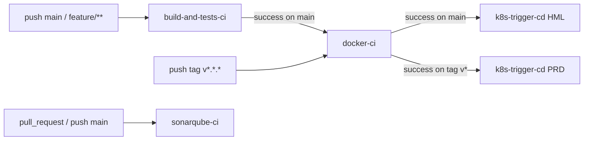

# CI / CD

Quatro workflows do GitHub Actions automatizam build, qualidade, publicação e deploy.



## Workflow 1 — `build-and-tests-ci.yml`

**Triggers:** push em `main` e `feature/**`.

### Etapas

1. Checkout (`actions/checkout`).
2. Setup .NET 10 (`actions/setup-dotnet`).
3. Cache de NuGet (chave: `runner.os` + hash de `Directory.Packages.props`).
4. `dotnet restore`.
5. `dotnet build --configuration Release --no-restore`.
6. **Verificação de Docker** (`docker --version` + `docker ps`) — necessário para os
   testes de integração (Testcontainers).
7. Instala `dotnet-reportgenerator-globaltool`.
8. `dotnet test ... --settings coverlet.runsettings` — gera cobertura em formato OpenCover
   em `.temp/coverage`.
9. ReportGenerator gera HTML + `Summary.json` (filtra `*.g.cs`, `*Designer.cs`,
   `Migrations/*.cs`).
10. Publica artefato `cobertura-html` (retenção 7 dias).
11. **Threshold ≥ 80%** de cobertura de linhas. Pipeline falha se abaixo.

> Não há secrets adicionais — só os tokens padrão do GitHub Actions.

## Workflow 2 — `docker-ci.yml`

**Triggers:**

- `workflow_run` quando o workflow 1 completa **com sucesso na branch `main`** (publica o
  commit exato que passou no CI, não o `HEAD` corrente da `main`).
- `push` em tags `v*.*.*` (releases — o tag em si é o gate).

Branches `feature/**` **não** publicam imagem; só viram imagem quando mergeadas em `main`.

### Imagem publicada

```text
mechermes/mecanica-hermes-api-ordem-servico:<tag>
```

Tags geradas (via `docker/metadata-action`):

| Tag | Quando |
| --- | --- |
| `sha-<short>` | Toda imagem publicada |
| `{{version}}`, `{{major}}.{{minor}}`, `{{major}}` | Em push de tag SemVer (ex.: `v1.2.3`) |
| `latest` | Apenas em build vindo do gate de CI na main |

### Plataformas

`linux/amd64` e `linux/arm64` (via QEMU + Buildx). Cache de camadas via `gha`.

### Secrets necessários

| Secret | Descrição |
| --- | --- |
| `DOCKER_USERNAME` | Usuário Docker Hub |
| `DOCKER_PASSWORD` | Senha ou token Docker Hub |

## Workflow 3 — `k8s-trigger-cd.yml`

**Trigger:** `workflow_run` do workflow 2.

| Branch da imagem | Ambiente disparado | `image_tag` enviada |
| --- | --- | --- |
| `main` | `hml` | `main` |
| `v*.*.*` (tag) | `prd` | versão sem o prefixo `v` (ex.: `1.2.3`) |

Faz `createWorkflowDispatch` em `fiap-challenge-13soat/mecanica-hermes-k8s/api-deploy.yml`.

### Secrets necessários

| Secret | Descrição |
| --- | --- |
| `K8S_REPO_PAT` | PAT com `actions:write` no repositório `mecanica-hermes-k8s`. |

## Workflow 4 — `sonarqube-ci.yml`

**Dashboard:** [sonarcloud.io/summary/new_code?id=fiap-challenge-13soat_mecanica-hermes-api-ordem-servico](https://sonarcloud.io/summary/new_code?id=fiap-challenge-13soat_mecanica-hermes-api-ordem-servico)

**Triggers:**

- `pull_request` (`opened`, `synchronize`, `reopened`) — análise com decoração no PR.
- `push` em `main` — análise da branch principal (linha de base do Quality Gate).

### Etapas

1. Checkout com `fetch-depth: 0` (necessário para análise de blame/SCM).
2. Setup do JDK 17 (`zulu`) — requisito do scanner.
3. Setup .NET 10 (`actions/setup-dotnet`).
4. Caches independentes: NuGet, pacotes do SonarCloud (`~/.sonar/cache`) e o próprio
   scanner (`dotnet-sonarscanner`, versão pinada em `SONAR_SCANNER_VERSION`).
5. Instala o `dotnet-sonarscanner` no `runner.temp` se o cache não bater.
6. **Begin/Build/Test/End** numa única step:
   - `dotnet-sonarscanner begin` com chave do projeto, organização, host, exclusões e
     `sonar.cs.opencover.reportsPaths`.
   - Em eventos `pull_request`, adiciona `sonar.pullrequest.key/branch/base` para
     habilitar a decoração e o Quality Gate de "new code".
   - `dotnet build --configuration Release`.
   - `dotnet test --no-build --settings coverlet.runsettings` — gera o relatório
     OpenCover que o scanner ingere.
   - `dotnet-sonarscanner end` envia tudo para o SonarCloud.

### Configurações de segurança

- `permissions:` mínimas (`contents: read`, `pull-requests: read`).
- `concurrency:` por `github.ref` com `cancel-in-progress: true` — evita análises
  redundantes em pushes consecutivos no mesmo PR.
- Token só via env (`SONAR_TOKEN`) — não passado em linha de comando.
- Refs do PR (`head_ref`, `base_ref`, número) expostos via `env:` antes de entrar no
  `run:` — evita risco de injeção via nome de branch.

### Secrets necessários

| Secret | Descrição |
| --- | --- |
| `SONAR_TOKEN` | Token gerado em SonarCloud → My Account → Security. |

## Dockerfile

[`Dockerfile`](../Dockerfile) é multi-stage:

- **`build`** (`mcr.microsoft.com/dotnet/sdk:10.0`) — copia primeiro só os `.csproj` para
  cachear o `restore`, depois publica em `Release` para `/app/publish`.
- **`runtime`** (`mcr.microsoft.com/dotnet/aspnet:10.0`) — usa o usuário não-root `app`
  (UID 1654) já incluído na imagem oficial, copia o publish com `--chown=app:app`
  e `--chmod=0555` (read-only execution), define `ASPNETCORE_HTTP_PORTS=8080`,
  expõe `8080`, entrypoint `dotnet Mecanica.Hermes.Api.dll`.

Práticas aplicadas:

- Usuário não-root `app` pré-criado pela imagem oficial — atende
  `runAsNonRoot: true` em Kubernetes sem `addgroup`/`adduser` (removidos das
  imagens .NET 10).
- Permissões `0555` (`r-xr-xr-x`) no diretório copiado — endurece o filesystem
  removendo o bit de escrita (atende `docker:S6504` do Sonar).
- Layer cache amigável (separa `restore` de `publish`).
- Sem ferramentas adicionais no estágio `runtime` (sem `curl`, sem `bash`).
