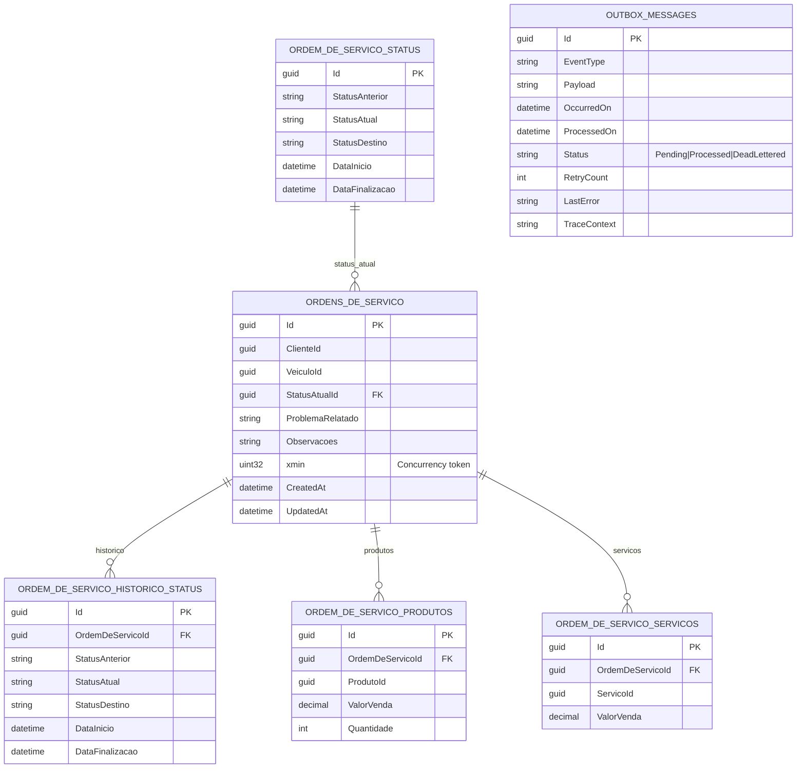

# Banco de dados

## Por que PostgreSQL

- **ACID transacional**: o Outbox depende de gravar estado + eventos na mesma transação.
- **`FOR UPDATE SKIP LOCKED`**: usado pelo `OutboxProcessor` para coordenar múltiplas
  réplicas sem race condition.
- **Índices parciais**: índice em `OutboxMessages (Status)` filtrado por `Status = Pending`.
- **`xmin`** é usado como concurrency token nativo do PostgreSQL (sem coluna manual de
  versionamento).
- **EF Core + Npgsql** maduros; banco gerenciado em produção via Amazon RDS.

> O provider InMemory (usado em alguns testes) **não** suporta filtros parciais nem
> `FOR UPDATE SKIP LOCKED` — o fallback é controlado por
> `OUTBOX__ALLOW_NON_LOCKING_FALLBACK=true` apenas em testes.

## Diagrama ER



## Decisões de modelagem

- **Snapshots em `OrdemDeServicoProdutos` e `OrdemDeServicoServicos`** — `ProdutoId` e
  `ServicoId` são referências lógicas (sem FK) para preservar histórico mesmo quando o
  catálogo externo muda preço/descrição.
- **Histórico explícito** em `OrdemDeServicoHistoricoStatus` — uma linha por transição,
  com `DataInicio` e `DataFinalizacao` do estado arquivado.
- **`xmin` como concurrency token** — sem coluna manual; conflitos são levantados como
  `ConcurrencyConflictException` no `EfUnitOfWork`.

## Índices relevantes

| Tabela | Índice | Uso |
| --- | --- | --- |
| `OrdensDeServico` | `(ClienteId, VeiculoId)` | Filtro por cliente/veículo |
| `OrdensDeServico` | `(StatusAtualId)` | Filtro por status atual |
| `OrdemDeServicoHistoricoStatus` | `(OrdemDeServicoId)` | Histórico da OS |
| `OrdemDeServicoProdutos` | `(OrdemDeServicoId)` | Itens da OS |
| `OrdemDeServicoServicos` | `(OrdemDeServicoId)` | Itens da OS |
| `OutboxMessages` | `(Status)` filtrado em `Status = Pending` | `OutboxProcessor` evita full-scan |

## Persistência de Saga (MongoDB)

A `OrdemDeServicoStateMachine` armazena seu estado em **MongoDB / DocumentDB**, configurado por:

- `MONGODB__CONNECTION_STRING`
- `MONGODB__SAGA_DATABASE`

Uma collection guarda `OrdemDeServicoState` (campos: `CorrelationId`, `CurrentState`,
`OperacaoEmAndamento`, `OperacaoIniciadaEm`, `UltimoMotivoFalha`,
`OperationTimeoutTokenId`).

## Migrations EF Core

### Comandos

```bash
# criar nova migration
just migration-add NomeDaMigration
# ou:
dotnet ef migrations add NomeDaMigration \
    --project src/Mecanica.Hermes.Infrastructure \
    --startup-project src/Mecanica.Hermes.Api

# aplicar (lê env var ConnectionStrings__DefaultConnection)
just migration-apply

# listar
just migration-list
```

A API aplica migrations automaticamente em startup via `MigrateDatabaseAsync` (Program.cs).
Para desabilitar isso em ambientes onde migrations rodam num pipeline separado, configure
`RUN_MIGRATIONS_ON_STARTUP=false`.

### Convenção de nome

Padrão `{Verbo}{Entidade}` em PascalCase. Exemplos no histórico:

- `InitialCreate`
- `AddOutboxMessages`
- `AlterOutboxAddStatusAndTraceContext`
- `AddXminConcurrencyToken`

**Não** use `Migration1`, `Temp`, `Fix`, `Test`, `Debug`. O nome deve descrever a mudança
de schema, não a data — a data já vem no prefixo gerado pelo EF.
