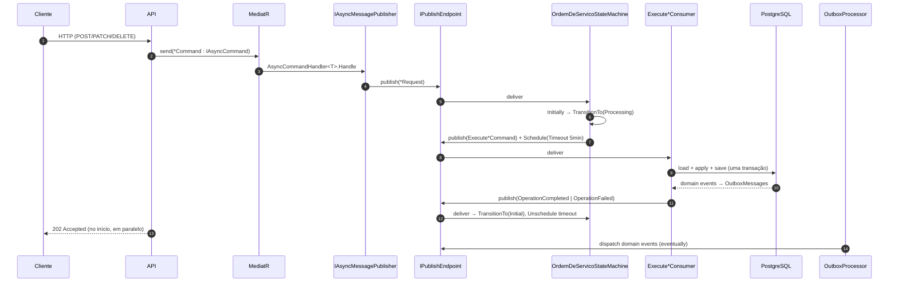
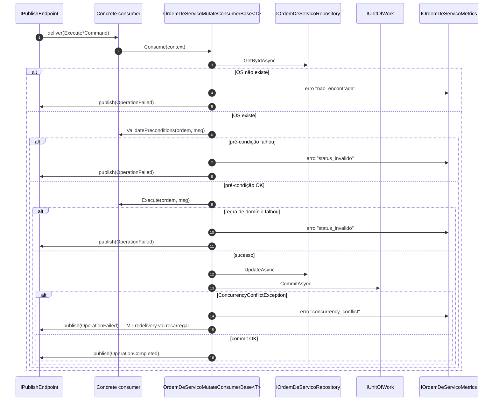
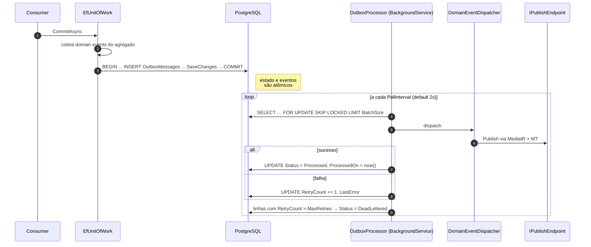

# Mensageria

Este documento descreve a SAGA, o pipeline de consumers, os contratos de mensagens e o
padrão Outbox transacional.

## Visão de conjunto

Toda operação de **mutação** segue o caminho:



Endpoints de **leitura** chamam o `IOrdemDeServicoReader` direto e respondem síncrono.

## SAGA — `OrdemDeServicoStateMachine`

A SAGA **serializa as operações por `OrdemDeServicoId`**: uma instância de SAGA por OS,
correlacionada por `CorrelateById(ctx => ctx.Message.OrdemDeServicoId)`.

| Estado | Eventos aceitos |
| --- | --- |
| `Initial` | Qualquer `*Request` → publica `Execute*Command` e transiciona para `Processing`. Eventos `OperationCompleted/Failed/TimedOut` são silenciosamente descartados (reentrega tardia). |
| `Processing` | Apenas `OperationCompleted`, `OperationFailed` ou `OperationTimeout`. **Todos os `*Request` recebidos são `Ignore` (descartados)** — garante "no máximo uma operação em voo". |

**Timeout sentinel.** Ao entrar em `Processing`, é agendado
`OrdemDeServicoOperationTimedOut` via `DelayedMessageScheduler` para `5 minutos` depois.
Caso o timer dispare antes do consumer responder, a SAGA volta para `Initial` registrando
`UltimoMotivoFalha`. O timer é cancelado (`Unschedule`) quando o evento de finalização
chega normalmente. Veja [ADR-014](./adrs.md#adr-014).

A persistência da SAGA é feita em **MongoDB** (`MONGODB__SAGA_DATABASE`), na collection
`ordem-de-servico-saga-state`.

## Contratos de mensagens

Os contratos vivem em
`src/Mecanica.Hermes.Application/OrdensDeServico/Messages/{Requests,Commands,Events}/`.

### Requests (HTTP → SAGA)

Publicados pelo `AsyncCommandHandler<T>` quando o endpoint envia um `IAsyncCommand`.

| Mensagem | Campos |
| --- | --- |
| `CreateOrdemDeServicoRequest` | `OrdemDeServicoId`, `ClienteId`, `VeiculoId`, `ProblemaRelatado?`, `Observacoes?` |
| `AvancarEtapaRequest` | `OrdemDeServicoId` |
| `ReverterEtapaRequest` | `OrdemDeServicoId` |
| `AprovarOrdemDeServicoRequest` | `OrdemDeServicoId` |
| `RejeitarOrdemDeServicoRequest` | `OrdemDeServicoId` |
| `PagamentoAprovadoRequest` | `OrdemDeServicoId` |
| `CancelarOrdemDeServicoRequest` | `OrdemDeServicoId` |
| `AddProdutoRequest` | `OrdemDeServicoId`, `ProdutoId`, `ValorVenda`, `Quantidade` |
| `AddServicoRequest` | `OrdemDeServicoId`, `ServicoId`, `ValorVenda` |
| `RemoveProdutoRequest` | `OrdemDeServicoId`, `ProdutoId` |
| `RemoveServicoRequest` | `OrdemDeServicoId`, `ServicoId` |

Marker interface: `IOrdemDeServicoRequest`.

### Execute commands (SAGA → consumer)

A SAGA publica essas mensagens internamente em resposta a um `*Request`. Cada uma é
consumida por um único consumer dedicado.

| Mensagem | Consumer |
| --- | --- |
| `ExecuteCreateOrdemDeServico` | `CreateOrdemDeServicoConsumer` (`OrdemDeServicoCreateConsumerBase`) |
| `ExecuteAvancarEtapa` | `AvancarEtapaConsumer` (`OrdemDeServicoMutateConsumerBase`) |
| `ExecuteReverterEtapa` | `ReverterEtapaConsumer` |
| `ExecuteAprovarOrdemDeServico` | `AprovarOrdemDeServicoConsumer` |
| `ExecuteRejeitarOrdemDeServico` | `RejeitarOrdemDeServicoConsumer` |
| `ExecutePagamentoAprovado` | `PagamentoAprovadoConsumer` |
| `ExecuteCancelarOrdemDeServico` | `CancelarOrdemDeServicoConsumer` |
| `ExecuteAddProduto` | `AddProdutoConsumer` |
| `ExecuteAddServico` | `AddServicoConsumer` |
| `ExecuteRemoveProduto` | `RemoveProdutoConsumer` |
| `ExecuteRemoveServico` | `RemoveServicoConsumer` |

Marker interface: `IOrdemDeServicoExecuteCommand`.

### Events (consumer → SAGA)

Publicados pelos consumers ao final do pipeline. Servem para a SAGA finalizar o estado
`Processing`.

| Mensagem | Campos |
| --- | --- |
| `OrdemDeServicoOperationCompleted` | `OrdemDeServicoId`, `Operacao` |
| `OrdemDeServicoOperationFailed` | `OrdemDeServicoId`, `Operacao`, `Motivo` |
| `OrdemDeServicoOperationTimedOut` | `OrdemDeServicoId`, `Operacao` |

> **Por que `Request` e `Execute*` carregam os mesmos campos mas existem separados?**
> Veja [ADR-006](./adrs.md#adr-006). Em resumo: `Request` representa a *intenção do
> cliente* e vai para a fila da SAGA; `Execute*` representa a *ordem operacional do
> orquestrador* e vai para a fila do consumer. Filas separadas permitem `Ignore` na SAGA
> sem que os consumers vejam mensagens duplicadas.

## Pipeline de consumers (Template Method)

Os consumers que mutam o agregado herdam de `OrdemDeServicoMutateConsumerBase<TCommand>`,
que centraliza o pipeline padrão.



### Hooks expostos pela base

| Hook | Obrigatório? | Para quê |
| --- | --- | --- |
| `Result Execute(OrdemDeServico, TCommand)` | Sim | Aplica a regra de negócio. |
| `Result ValidatePreconditions(OrdemDeServico, TCommand)` | Não (default `Result.Ok()`) | Valida pré-condições além de "agregado existe" — ex.: status correto. |
| `string OperacaoMetricKey` | Não (default = `typeof(TCommand).Name`) | Override para chave snake_case nas métricas (ex.: `aprovar`). |

### Exemplo — `AddProdutoConsumer`

```csharp
public sealed class AddProdutoConsumer(IOrdemDeServicoRepository repository, IUnitOfWork uow)
    : OrdemDeServicoMutateConsumerBase<ExecuteAddProduto>(repository, uow)
{
    protected override Result Execute(OrdemDeServico ordem, ExecuteAddProduto msg) =>
        ordem.AdicionarProduto(msg.ProdutoId, msg.ValorVenda, msg.Quantidade);
}
```

### Exemplo — `AprovarOrdemDeServicoConsumer` (com pré-condição e métrica nomeada)

```csharp
public sealed class AprovarOrdemDeServicoConsumer(
    IOrdemDeServicoRepository repository,
    IUnitOfWork uow,
    IOrdemDeServicoMetrics metrics)
    : OrdemDeServicoMutateConsumerBase<ExecuteAprovarOrdemDeServico>(repository, uow, metrics)
{
    protected override string OperacaoMetricKey => OrdemDeServicoMetricKeys.Operations.Aprovar;

    protected override Result ValidatePreconditions(OrdemDeServico ordem, ExecuteAprovarOrdemDeServico msg) =>
        ordem.StatusAtual.StatusAtual == OrdemDeServicoStatus.AguardandoAprovacao
            ? Result.Ok()
            : Result.BadRequest("Ordem de serviço precisa estar em aguardando aprovação para ser aprovada.");

    protected override Result Execute(OrdemDeServico ordem, ExecuteAprovarOrdemDeServico msg) =>
        ordem.AvancarEtapa();
}
```

### Caso especial — `CreateOrdemDeServicoConsumer`

A criação não carrega um agregado existente — usa `OrdemDeServicoCreateConsumerBase<T>`
em vez de `Mutate`. O hook é `Result<OrdemDeServico> CreateAggregate(TCommand)` e o
pipeline chama `AddAsync` em vez de `UpdateAsync`. Veja [ADR-011](./adrs.md#adr-011).

## Outbox

Domain events disparados pelo agregado **não saem direto pelo bus** — são gravados como
linhas em `OutboxMessages` na **mesma transação** do `SaveChangesAsync`. Um background
service consome e despacha.



### Garantias

- **Atomicidade:** se a transação do agregado falha, nem o estado nem os eventos persistem.
- **At-least-once:** após o commit, o evento *vai* ser despachado eventualmente
  (handlers downstream devem ser idempotentes — política consistente com a SAGA).
- **No multi-réplica:** `FOR UPDATE SKIP LOCKED` (PostgreSQL) garante que cada linha é
  processada por uma instância só. O fallback LINQ (sem locking) só é habilitado para
  testes via `OUTBOX__ALLOW_NON_LOCKING_FALLBACK`.
- **Discriminador estável:** o tipo do evento usa `DomainEventNameAttribute`
  (ex.: `"ordem-de-servico.criado.v1"`) em vez de `AssemblyQualifiedName`, imune a
  refactor de namespace.

### Configuração

Tudo via `OutboxOptions` (env vars com prefixo `OUTBOX__`):

| Opção | Default |
| --- | --- |
| `PollInterval` | `2s` |
| `BatchSize` | `50` |
| `MaxRetries` | `OutboxMessageEntity.DefaultMaxRetries` |
| `ProcessedRetention` | `7 days` (cleanup roda em `OutboxCleanupService`) |
| `AllowNonLockingFallback` | `false` (só ativar em testes) |

## Transports suportados

A escolha do transport é feita pela env var `MASSTRANSIT__TRANSPORT_SERVICE`, que pode ser:

- `RabbitMq` (default em `launchSettings`)
- `AmazonSqs`
- `MongoDb`

Os três transports são empacotados juntos no assembly de Infrastructure
(ver [ADR-015](./adrs.md#adr-015)) — apenas o configurado em runtime é registrado.

## Plano: lib de contratos

Está planejada (não executada) a extração dos contratos de mensageria para
`Mecanica.Hermes.Contracts.OrdemDeServico`. Critério para extrair: aparição do **primeiro
consumidor externo** (outro serviço, BFF). Detalhes: [ADR-016](./adrs.md#adr-016).
