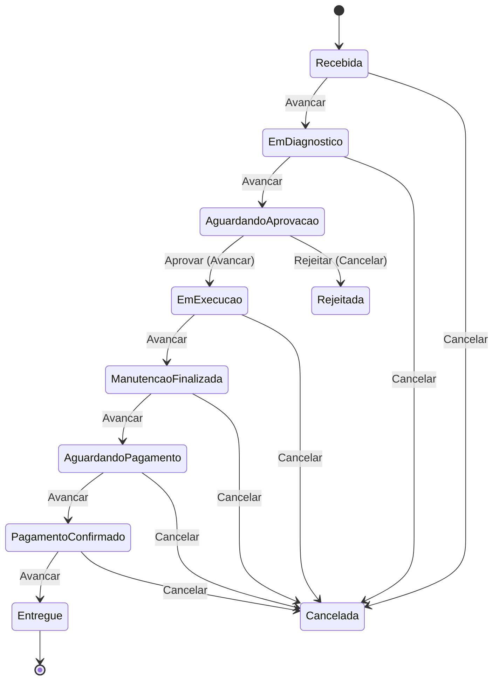

# Fluxo da Ordem de Serviço

A `OrdemDeServico` é o agregado raiz do domínio. Seu ciclo de vida é modelado com
**State Pattern**: cada estado é uma classe (`OrdemDeServicoStatusBase`) que conhece os
seus próprios alvos de transição e suas regras de edição.

## Máquina de estados



> **Reverter etapa** segue o caminho inverso (`StatusRevertido` em cada classe de status) e
> não é mostrado para manter o diagrama legível.

## Estados

| Estado | Próximo (`Avancar`) | Reversível? | Edita produtos/serviços? |
| --- | --- | --- | --- |
| `Recebida` | `EmDiagnostico` | Não | **Sim** |
| `EmDiagnostico` | `AguardandoAprovacao` | → `Recebida` | **Sim** |
| `AguardandoAprovacao` | `EmExecucao` | → `EmDiagnostico` | Não |
| `EmExecucao` | `ManutencaoFinalizada` | → `AguardandoAprovacao` | Não |
| `ManutencaoFinalizada` | `AguardandoPagamento` | → `EmExecucao` | Não |
| `AguardandoPagamento` | `PagamentoConfirmado` | → `ManutencaoFinalizada` | Não |
| `PagamentoConfirmado` | `Entregue` | → `AguardandoPagamento` | Não |
| `Entregue` | — *(terminal)* | → `PagamentoConfirmado` | Não |
| `Rejeitada` | — *(terminal)* | → `AguardandoAprovacao` | Não |
| `Cancelada` | — *(terminal)* | — | Não |

## Operações

| Operação | Onde se aplica | Efeito |
| --- | --- | --- |
| `AvancarEtapa` | qualquer estado não-terminal | Transiciona para `ProximoStatus`. |
| `ReverterEtapa` | qualquer estado com predecessor | Transiciona para `StatusRevertido`. |
| `Cancelar` | qualquer estado não-terminal | Transiciona para `Cancelada`. |
| `Aprovar` | apenas em `AguardandoAprovacao` | Equivalente a `AvancarEtapa` com guard de status. |
| `Rejeitar` | apenas em `AguardandoAprovacao` | Equivalente a `Cancelar` (transiciona para `Rejeitada`). |
| `PagamentoAprovado` | apenas em `AguardandoPagamento` | Equivalente a `AvancarEtapa` com guard de status (avança para `PagamentoConfirmado`). |
| `AdicionarProduto` / `RemoverProduto` | estados com `PermiteEditarProdutos = true` | Modifica a lista de produtos. |
| `AdicionarServico` / `RemoverServico` | estados com `PermiteEditarProdutos = true` | Modifica a lista de serviços. |

## Histórico

Toda transição registra um `OrdemDeServicoHistoricoStatus` com `DataInicio`/`DataFinalizacao`
do estado *que está sendo arquivado*. O histórico é parte do agregado e é serializado nas
respostas de query.

## Eventos de domínio

| Evento | Quando é disparado |
| --- | --- |
| `OrdemDeServicoCriadoEvent` | Em `OrdemDeServico.Criar(...)` (estado inicial `Recebida`). |
| `OrdemDeServicoEtapaAvancadaEvent` | Em `AvancarEtapa()` bem-sucedido. |
| `OrdemDeServicoEtapaRevertidaEvent` | Em `ReverterEtapa()` bem-sucedido. |
| `OrdemDeServicoCanceladaEvent` | Em `Cancelar()` bem-sucedido (incluindo `Rejeitar`). |

Os eventos são gravados no Outbox dentro da mesma transação do `SaveChangesAsync` e
despachados pelo `OutboxProcessor`. Veja [messaging.md](./messaging.md#outbox).

## Snapshots de produtos e serviços

`OrdemDeServicoProduto` e `OrdemDeServicoServico` são **entidades filhas que armazenam
preço e descrição no momento da criação** — `ProdutoId`/`ServicoId` são referências lógicas
sem FK no banco para preservar histórico mesmo após o catálogo mudar.

`ValorTotal` é calculado a partir desses snapshots:

```text
ValorTotal = Σ(produto.ValorVenda × produto.Quantidade)
           + Σ(serviço.ValorVenda)
```
